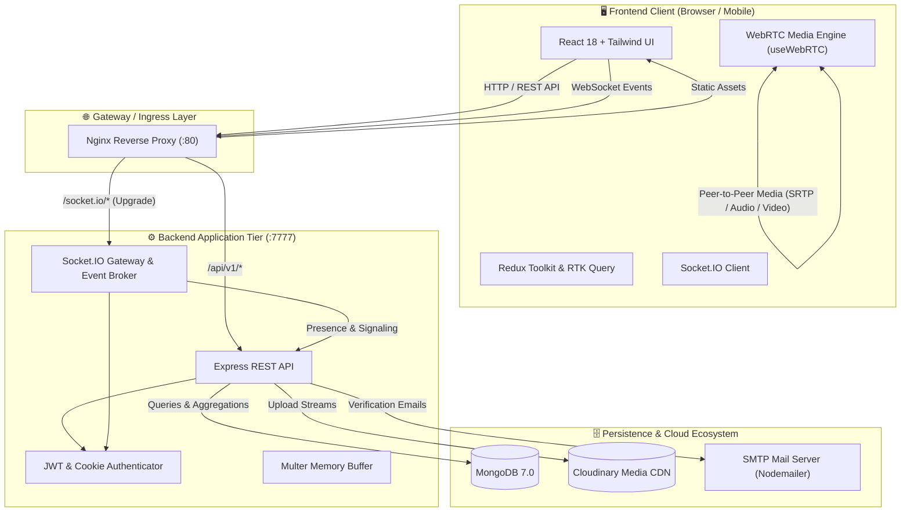
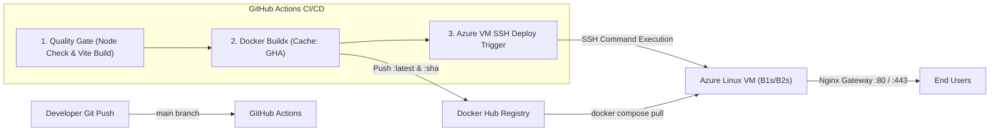

# PulseChat — Enterprise-Grade Real-Time Communication Platform

<p align="center">
  
</p>

<p align="center">
  <strong>A high-concurrency, full-stack real-time messaging, WebRTC audio/video calling, and group collaboration platform built with React 18, Node.js, Express, Socket.IO, MongoDB, and Tailwind CSS. Fully containerized with Docker & Nginx.</strong>
</p>

<p align="center">
  <a href="https://nodejs.org/"></a>
  <a href="https://react.dev/"></a>
  <a href="https://vitejs.dev/"></a>
  <a href="https://socket.io/"></a>
  <a href="https://webrtc.org/"></a>
  <a href="https://www.mongodb.com/"></a>
  <a href="https://tailwindcss.com/"></a>
  <a href="https://www.docker.com/"></a>
  <a href="https://nginx.org/"></a>
</p>

---

## 📑 Table of Contents

- [Architectural Overview](#-architectural-overview)
- [System Architecture Diagram](#-system-architecture-diagram)
- [Core Features](#-core-features)
  - [1. Real-Time Messaging & Presence](#1-real-time-messaging--presence)
  - [2. Peer-to-Peer WebRTC Audio & Video Calling](#2-peer-to-peer-webrtc-audio--video-calling)
  - [3. Social Graph & Group Management](#3-social-graph--group-management)
  - [4. Security, Auth & Cloud Infrastructure](#4-security-auth--cloud-infrastructure)
  - [5. Senior UI/UX & Responsive Engineering](#5-senior-uiux--responsive-engineering)
- [Technology Stack](#-technology-stack)
- [Project Directory Structure](#-project-directory-structure)
- [Docker & Container Orchestration](#-docker--container-orchestration)
  - [Architecture of Docker Services](#architecture-of-docker-services)
  - [Production Launch with Docker Compose](#production-launch-with-docker-compose)
  - [Docker Health Checks & Resiliency](#docker-health-checks--resiliency)
- [Local Bare-Metal Development Setup](#-local-bare-metal-development-setup)
  - [Prerequisites](#prerequisites)
  - [Backend Setup](#backend-setup)
  - [Client Setup](#client-setup)
- [Environment Variables Specification](#-environment-variables-specification)
- [REST API Reference](#-rest-api-reference)
- [WebSocket & Real-Time Event Pipeline](#-websocket--real-time-event-pipeline)
- [WebRTC Signaling State Flow](#-webrtc-signaling-state-flow)
- [Production Deployment Guidelines](#-production-deployment-guidelines)
- [Contributing & License](#-contributing--license)

---

## 🏛️ Architectural Overview

PulseChat is structured as an enterprise-grade, decoupled client-server architecture engineered for high availability, low latency, and horizontal scalability:

1. **Client Tier**: A Single Page Application (SPA) powered by **React 18** and **Vite 5**. State synchronization is managed using **Redux Toolkit** and **RTK Query** with optimistic UI updates and normalized caching.
2. **Reverse Proxy & Ingress Tier**: A production **Nginx** container that acts as an API gateway, serves optimized static assets with gzip compression, terminates HTTP/1.1 traffic, and seamlessly proxies WebSocket upgrades (`Upgrade: websocket`) to the backend with long-lived connection timeouts.
3. **Application & WebSocket Tier**: A **Node.js (ES Modules)** / **Express** microservice that handles RESTful business logic, file transformations, and cryptographic validation. Integrated with **Socket.IO** for event-driven bi-directional communication over WebSockets with HTTP-only cookie-based session verification.
4. **Media & Signaling Tier**: **Native WebRTC** peer-to-peer audio/video streaming with STUN servers, utilizing the Socket.IO cluster for SDP offer/answer exchanges and ICE candidate dispatch.
5. **Persistence Tier**: **MongoDB 7.0** utilizing index-optimized schemas via Mongoose for rapid message pagination, user relationships, and group memberships.
6. **Cloud Services Tier**: **Cloudinary** for multi-format binary streaming (images, videos, audio clips, PDFs) and **Nodemailer** for automated SMTP transactional emails (account verification and password resets).

---

## 📊 System Architecture Diagram



---

## ✨ Core Features

### 1. Real-Time Messaging & Presence
- **Sub-100ms Latency**: Instant messaging delivered through persistent Socket.IO connections.
- **Dynamic Delivery Receipts**: Real-time status tags (`Sent ✓`, `Delivered ✓✓`, and `Seen [Avatar]`).
  - *Clean UX*: The seen avatar badge renders **only beneath your latest sent message**, avoiding repetitive visual noise.
- **Smart Quoting & Reply System**: Quote any message in a conversation. Text excerpts are automatically clamped to 65–75 characters with an ellipsis (`...`) to prevent message bubble overflow.
- **Typing Indicators**: Real-time animated typing status with automatic debounce timeouts.
- **Rich Media & File Attachments**: Drag-and-drop or file-picker upload for images, video files, voice notes, PDFs, and general attachments, hosted securely on Cloudinary.
- **Infinite Scroll Pagination**: Upward scrolling loads previous chunks without jarring scroll jumps using custom scroll hooks.
- **Message Deletion ("Delete for Me")**: Real-time optimistic deletion removing messages from the client interface while updating persistence.
- **Global Presence Tracking**: Accurate online/offline presence indicators across friend lists, profile cards, and chat headers with last-seen timestamps.

### 2. Peer-to-Peer WebRTC Audio & Video Calling
- **Native WebRTC Integration**: High-definition, low-latency audio and video calls directly between browsers using `RTCPeerConnection` and Google STUN infrastructure.
- **Socket.IO Signaling Protocol**: Reliable transmission of `CALL_INITIATE`, `CALL_ACCEPTED`, `CALL_DECLINED`, `CALL_ENDED`, and `ICE_CANDIDATE` payloads.
- **Synthesized Audio Feedback**: Built-in Web Audio API oscillators synthesize realistic ringtones, call-waiting tones, and hangup signals without loading external audio assets.
- **Floating Minimized PiP Widget**: Ongoing calls can be minimized into a persistent floating widget in the corner of the application, allowing users to navigate through chats and profiles without interrupting the call.
- **In-Chat Call History**: Completed, declined, or missed calls automatically log clean interactive call event tiles into the chat history with duration timers and one-click redial actions.

### 3. Social Graph & Group Management
- **User Discovery**: Instant debounced user search across the registered user base.
- **Friend Request Engine**: Send, accept, or decline friend requests with real-time notification alerts and badge counters.
- **Group Conversations**: Create multi-user group chats with custom avatars and custom titles.
- **Group Administration**: Group creators can add members, remove participants, rename channels, or dissolve groups. Members can gracefully leave groups at any time.

### 4. Security, Auth & Cloud Infrastructure
- **Cookie-Based Authentication**: JSON Web Tokens (JWT) stored in `HttpOnly`, `SameSite: None/Lax`, `Secure` cookies to mitigate Cross-Site Scripting (XSS) and CSRF attacks.
- **Password Security**: Strong hashing using `bcryptjs` with configurable salt rounds.
- **Email Verification**: Two-step registration requiring email token confirmation before account activation.
- **Password Recovery**: Secure, time-limited reset tokens delivered via automated transactional emails that route back to the frontend reset interface.
- **Input Validation**: Sanitization and schema validation at the HTTP layer using `express-validator`.
- **CORS Matrix**: Dynamically accepts requests from localhost, private local area networks (LAN IPs for mobile testing), and production deployments.

### 5. Senior UI/UX & Responsive Engineering
- **Unified Single-Scrollbar Architecture**: The viewport height is constrained to `100vh` on chat views (`overflow: hidden`), removing outer browser scrollbars.
- **Hidden Internal Scrollbars**: Custom `.custom-scrollbar` utility classes hide browser scrollbars across message containers and conversation sidebars while retaining full touch swipe and mouse-wheel scrolling.
- **Dark / Light Theme**: Built-in modern dark glassmorphism design with Tailwind CSS and Framer Motion micro-interactions.
- **Responsive Layout**: Fluid breakpoints adapting smoothly from mobile devices (drawer-based group info and chat navigation) to ultra-wide desktop monitors.

---

## 🛠️ Technology Stack

| Layer | Technology | Purpose |
| :--- | :--- | :--- |
| **Frontend Framework** | React 18 | Declarative component architecture & hooks |
| **Build Tooling** | Vite 5 | Lightning-fast HMR and optimized Rollup production bundling |
| **State Management** | Redux Toolkit & RTK Query | Normalized server state, automatic caching, and UI slices |
| **Real-Time Client** | Socket.IO Client 4.x | Event-driven WebSocket client |
| **Calling / Media** | WebRTC Native API | Peer-to-peer real-time audio/video streaming |
| **Styling & Motion** | Tailwind CSS 3.x & Framer Motion | Utility-first styling with hardware-accelerated animations |
| **Icons & Notifications** | React Icons & Sonner | Modern iconography and accessible toast notifications |
| **Backend Runtime** | Node.js 20 LTS (ES Modules) | High-throughput asynchronous JavaScript runtime |
| **Application Framework** | Express 4.x | RESTful API routing, middleware, and controllers |
| **Real-Time Server** | Socket.IO 4.x | Clustered WebSocket server with cookie auth |
| **Database** | MongoDB 7.0 & Mongoose 8.x | Document-oriented persistence with schema modeling |
| **Media Cloud Storage** | Cloudinary SDK v2 | Cloud asset storage, image optimization, and CDN delivery |
| **Email Delivery** | Nodemailer 6.x | Transactional SMTP email delivery |
| **Containerization** | Docker & Docker Compose | Multi-container isolation and microservice orchestration |
| **Web Server / Ingress** | Nginx Alpine 1.27 | Static asset hosting, Gzip compression, reverse proxying |

---

## 📁 Project Directory Structure

```text
Chat-app/
├── .env.example                     # Master environment variable template
├── docker-compose.yml               # Multi-service production Docker Compose config
├── README.md                        # Senior-level project documentation
│
├── backend/                         # Node.js + Express + Socket.IO API
│   ├── .dockerignore                # Docker ignore definitions for backend
│   ├── Dockerfile                   # Production multi-stage Alpine Dockerfile
│   ├── package.json                 # Backend dependencies & npm scripts
│   ├── package-lock.json            # Deterministic lockfile
│   └── src/
│       ├── server.js                # HTTP server initialization & DB bootstrap
│       ├── app.js                   # Express application, Socket.IO setup, CORS
│       ├── secret.js                # Centralized environment variable loader
│       ├── constants/
│       │   └── event.js             # Shared Socket.IO event dictionary
│       ├── controllers/
│       │   ├── auth.controller.js   # Login, registration, logout, session
│       │   ├── chat.controller.js   # 1-on-1, groups, attachments, message history
│       │   └── user.controller.js   # Friends, requests, profiles, password reset
│       ├── db/
│       │   └── config/connectDB.js  # Mongoose connection handler
│       ├── helper/
│       │   ├── cloudinary.js        # Cloudinary stream uploader
│       │   ├── jsonWebToken.js      # JWT signing & verification utilities
│       │   ├── responseHandler.js   # Standardized JSON API response formatters
│       │   └── socketIo.js          # Socket connection life-cycle & event handlers
│       ├── middlewares/
│       │   ├── auth.js              # HTTP & Socket.IO JWT cookie authentication
│       │   └── multer.js            # In-memory multipart buffer processing
│       ├── models/
│       │   ├── chat.model.js        # Conversation schema (direct & group)
│       │   ├── message.model.js     # Message schema (text, attachments, calls, seen)
│       │   └── user.model.js        # User profile, friends, and credentials
│       ├── routes/
│       │   ├── admin.route.js       # Administrative endpoints
│       │   ├── auth.route.js        # Authentication endpoints
│       │   ├── chat.route.js        # Chat, group, and message endpoints
│       │   ├── notification.route.js# Push and internal notification endpoints
│       │   ├── support.route.js     # User support ticketing
│       │   └── user.route.js        # User relations, search, and profiles
│       └── validation/              # express-validator schemas & validation runner
│
└── client/                          # React 18 + Vite Frontend Application
    ├── .dockerignore                # Docker ignore definitions for frontend
    ├── Dockerfile                   # Multi-stage build (Node build -> Nginx Alpine)
    ├── nginx.conf                   # Production Nginx reverse proxy configuration
    ├── package.json                 # Frontend dependencies & npm scripts
    ├── package-lock.json            # Deterministic lockfile
    ├── vite.config.js               # Vite build and development proxy configuration
    ├── tailwind.config.js           # Tailwind theme configuration
    └── src/
        ├── App.jsx                  # Top-level application routing
        ├── Layout.jsx               # Viewport lock, Navbar, Footer, and Call Widget
        ├── Socket.jsx               # Global Socket.IO context provider
        ├── SocketHelper.jsx         # Custom hook for Socket context consumption
        ├── app/
        │   ├── api/api.js           # RTK Query API endpoints & caching definitions
        │   └── store.js             # Redux Toolkit centralized store configuration
        ├── components/
        │   ├── call/                # Minimized call widgets and controls
        │   ├── navbar/              # Header navigation, search, and notification bell
        │   └── ui/                  # Reusable UI components & Toaster
        ├── context/
        │   └── CallContext.jsx      # Global WebRTC call state management
        ├── hooks/
        │   ├── useAsyncMutationHook.jsx # Unified RTK mutation wrapper with toasts
        │   ├── useOnlineStatus.jsx  # Real-time WebSocket user presence hook
        │   └── useWebRTC.jsx        # PeerConnection, stream management & signaling
        ├── pages/
        │   ├── chat/                # Chat workspace, message views, sidebar
        │   ├── forgot-password/     # Password reset request and confirmation
        │   ├── friends/             # Full friends directory
        │   ├── login/ & sign-up/    # Authentication pages
        │   └── profile/             # Profile overview, edit, and group creation
        └── utils/
            ├── alert.jsx            # Standardized Sonner toast wrappers
            └── callSounds.js        # Web Audio API call tone synthesizers
```

---

## 🐳 Docker & Container Orchestration

PulseChat is fully containerized using **Docker** and **Docker Compose**, providing a zero-configuration, production-grade deployment with isolated networking, persistent volumes, and health monitoring.

### Architecture of Docker Services

```text
[ Client Container (Nginx Alpine) ] :80 / :5173
   ├── Serves React Production Static Bundle
   ├── Proxies /api/      ───> [ Backend Container (Node 20 Alpine) ] :7777
   └── Proxies /socket.io ───> [ Backend Container (Socket.IO) ]      :7777
                                       └── Connects to ───> [ Mongo Container (Mongo 7.0) ] :27017
                                                                    └── Volume: mongodb_data
```

### Production Launch with Docker Compose

1. **Configure Environment Variables**:
   Copy the provided `.env.example` file to `.env`:
   ```bash
   cp .env.example .env
   ```
   *(Update your Cloudinary, SMTP, and JWT keys in `.env` as needed)*

2. **Build and Start All Services**:
   ```bash
   docker compose up -d --build
   ```

3. **Verify Service Health**:
   ```bash
   docker compose ps
   ```
   All three containers (`chat_app_mongodb`, `chat_app_backend`, and `chat_app_client`) will report `healthy`.

4. **Access the Application**:
   - **Frontend (Web Application)**: [http://localhost](http://localhost) (or [http://localhost:5173](http://localhost:5173))
   - **Backend API**: [http://localhost:7777/api/v1/health](http://localhost:7777/api/v1/health)
   - **MongoDB Port**: `localhost:27017`

5. **Stop Containers**:
   ```bash
   docker compose down
   ```
   *(Add `-v` to also remove the database volume: `docker compose down -v`)*

### Docker Health Checks & Resiliency
- **MongoDB**: Automatically executes `mongosh --eval 'db.adminCommand("ping")'` every 10 seconds.
- **Backend API**: Executes `wget http://localhost:7777/api/v1/health` and will not accept traffic until the database connection is verified.
- **Client (Nginx)**: Queries `/healthz` to guarantee the web server is actively serving requests.
- **Restart Policies**: Configured with `restart: unless-stopped` for high-uptime recovery from unexpected process terminations.

---

## 💻 Local Bare-Metal Development Setup

If you prefer to run the application directly on your local machine without Docker:

### Prerequisites
- **Node.js**: v18.0.0 or v20.0.0+ ([Download Node.js](https://nodejs.org/))
- **npm**: v9.0.0+
- **MongoDB**: Local MongoDB instance running on `localhost:27017` or a [MongoDB Atlas](https://www.mongodb.com/atlas) connection URI.

---

### Backend Setup

1. Open a terminal and navigate to the backend directory:
   ```bash
   cd backend
   ```

2. Install dependencies:
   ```bash
   npm install
   ```

3. Create the backend `.env` file:
   ```bash
   cp ../.env.example .env
   ```
   Ensure `MONGODB_URL` points to your local MongoDB:
   ```env
   PORT=7777
   MONGODB_URL=mongodb://localhost:27017/chat_app
   FRONTEND_URL1=http://localhost:5173
   ```

4. Start the backend development server:
   ```bash
   npm run dev
   ```
   The backend will start on **`http://localhost:7777`**.

---

### Client Setup

1. Open a second terminal and navigate to the client directory:
   ```bash
   cd client
   ```

2. Install dependencies:
   ```bash
   npm install
   ```

3. Start the Vite development server:
   ```bash
   npm run dev
   ```
   The client will start with HMR on **`https://localhost:5173`** or **`http://localhost:5173`**.

---

## 🔑 Environment Variables Specification

Below is the complete reference of all environment variables used by the application:

| Variable Name | Required | Default / Example | Purpose |
| :--- | :---: | :--- | :--- |
| `PORT` | Optional | `7777` | Port on which the Express HTTP & Socket server listens. |
| `NODE_ENV` | Optional | `production` / `development` | Application runtime environment mode. |
| `MONGODB_URL` | **Yes** | `mongodb://mongo:27017/chat_app` | MongoDB connection string (local or Atlas URI). |
| `FRONTEND_URL1` | **Yes** | `http://localhost:5173` | Allowed origin for CORS and cookie transmission. |
| `FRONTEND_URL2` | Optional | `http://localhost:80` | Secondary allowed origin. |
| `FRONTEND_URL3` | Optional | `http://localhost:3000` | Tertiary allowed origin. |
| `JSON_WEB_TOKEN_KEY` | **Yes** | *32+ character random string* | Master secret key used to sign authentication JWTs. |
| `ACCESS_TOKEN_KEY` | **Yes** | *32+ character random string* | Secret key for access tokens. |
| `REFRESH_TOKEN_KEY` | **Yes** | *32+ character random string* | Secret key for persistent refresh tokens. |
| `RESET_PASSWORD_KEY` | **Yes** | *32+ character random string* | Secret key for signing password reset tokens. |
| `CLOUDINARY_CLOUDE_NAME` | **Yes** | `my_cloud_name` | Cloudinary account cloud name for media storage. |
| `CLOUDINARY_API_KEY` | **Yes** | `123456789012345` | Cloudinary API Key. |
| `CLOUDINARY_SECRET_KEY` | **Yes** | `abcdef1234567890` | Cloudinary API Secret. |
| `SMTP_USERNAME` | **Yes** | `notifications@domain.com` | SMTP account email for verification & reset emails. |
| `SMTP_PASSWORD` | **Yes** | `xxxx xxxx xxxx xxxx` | SMTP app password. |
| `PUBLIC_VAPID_KEY` | Optional | *VAPID Public Key* | Public key for browser Web Push notifications. |
| `PRIVATE_VAPID_KEY`| Optional | *VAPID Private Key* | Private key for browser Web Push notifications. |
| `ADMIN_LOGIN_PATH` | Optional | `/admin-portal` | Custom URI path for administrative authentication. |
| `ADMIN_LOGIN_EMAIL`| Optional | `admin@pulsechat.com` | Master administrative user email. |
| `ADMIN_LOGIN_PASSWORD`| Optional| `StrongPassword!` | Master administrative user password. |

---

## 📡 REST API Reference

All REST endpoints are namespaced under the `/api/v1` prefix.

### Authentication (`/api/v1/auth`)
| Method | Endpoint | Auth | Description |
| :--- | :--- | :---: | :--- |
| `GET` | `/` | User | Get current logged-in user profile from session cookie. |
| `POST` | `/login` | Public | Authenticate user with credentials; sets `HttpOnly` token cookie. |
| `GET` | `/log-out` | User | Clear session cookies and invalidate user token. |

### Users & Relationships (`/api/v1/user`)
| Method | Endpoint | Auth | Description |
| :--- | :--- | :---: | :--- |
| `POST` | `/process-register` | Public | Stage user registration, process avatar upload, and dispatch verification email. |
| `POST` | `/verify` | Public | Verify registration token and activate account. |
| `POST` | `/forgot-password` | Public | Dispatch password reset email with secure token. |
| `PUT` | `/reset-password` | Public | Reset password using verified token. |
| `GET` | `/single-user/:userId` | User | Fetch detailed user card information. |
| `GET` | `/search-user?name=:query` | User | Search for users by username or display name. |
| `POST` | `/send-request` | User | Send a friend request to a target user. |
| `PUT` | `/accept-request` | User | Accept an incoming friend request. |
| `PUT` | `/delete-request` | User | Reject or cancel a pending friend request. |
| `GET` | `/get-friends/:userId` | User | Retrieve full friends list with real-time online status. |
| `GET` | `/friend-requests` | User | Retrieve list of incoming friend requests. |
| `PUT` | `/edit-profile` | User | Update display name, bio, or avatar. |

### Chats, Groups & Messages (`/api/v1/chat`)
| Method | Endpoint | Auth | Description |
| :--- | :--- | :---: | :--- |
| `GET` | `/my-chats` | User | Fetch all active 1-on-1 conversations and groups for user. |
| `GET` | `/my-groups` | User | Fetch all groups created by or joined by user. |
| `POST` | `/create-group` | User | Create a new group chat with name, members, and avatar. |
| `GET` | `/chat-details/:id` | User | Retrieve metadata, member rosters, and admins for a chat. |
| `PUT` | `/add-group-member` | Admin | Add one or more friends to an existing group. |
| `PUT` | `/remove-member` | Admin | Remove a user from a group. |
| `DELETE`| `/leave-group/:id` | User | Leave a group conversation. |
| `PUT` | `/rename-group/:id` | Admin | Rename a group conversation. |
| `GET` | `/message/:chatId?page=:n`| User | Retrieve paginated message history for a chat. |
| `POST` | `/send-attachments` | User | Upload and dispatch binary media attachments to a chat. |
| `DELETE`| `/message/:id` | User | Delete a specific message on the user's side ("Delete for me"). |
| `DELETE`| `/delete-chat/:id` | User | Delete a conversation and its messages for the user. |

---

## ⚡ WebSocket & Real-Time Event Pipeline

PulseChat leverages **Socket.IO** for instantaneous communication. The server authenticates incoming WebSocket handshakes by extracting and decoding the JWT from the connection cookie.

| Event Name | Direction | Payload | Description |
| :--- | :---: | :--- | :--- |
| `NEW_MESSAGE` | Client ⇄ Server | `{ chatId, message, sender, createdAt }` | Dispatches a new chat message to members of a conversation. |
| `NEW_MESSAGE_ALERT` | Server → Client | `{ chatId, count }` | Updates unread message counters in the sidebar. |
| `START_TYPING` | Client → Server | `{ chatId, members }` | Broadcasts typing state to conversation participants. |
| `STOP_TYPING` | Client → Server | `{ chatId, members }` | Clears typing indicator for conversation participants. |
| `MESSAGES_DELIVERED` | Server → Client | `{ chatId, messageIds }` | Marks messages as delivered to the recipient's device. |
| `MESSAGES_SEEN` | Client ⇄ Server | `{ chatId, seenBy, messageIds }` | Emits seen status; triggers the recipient's avatar badge display. |
| `USER_ONLINE` | Server → Client | `{ userId }` | Broadcasts user online status on socket connection. |
| `USER_OFFLINE` | Server → Client | `{ userId, lastOnline }` | Broadcasts user offline status and disconnect timestamp. |
| `ONLINE_USERS_LIST` | Server → Client | `[ userId1, userId2, ... ]` | Full array of currently connected active user IDs. |
| `NEW_FRIEND_REQUEST` | Server → Client | `{ senderId, senderName }` | Triggers real-time notification badge on the friend request tab. |

---

## 📞 WebRTC Signaling State Flow

Audio and video calls use peer-to-peer WebRTC connections established through Socket.IO signaling:

```mermaid
sequenceDiagram
    autonumber
    actor Caller as Caller (User A)
    participant Socket as Socket.IO Signaling Server
    actor Callee as Callee (User B)

    Caller->>Socket: emit("CALL_USER", { to: UserB, offer, callType })
    Socket->>Callee: emit("CALL_USER", { from: UserA, offer, callType })
    Note over Callee: Web Audio API plays ringtone.<br/>Incoming Call Dialog displays.

    alt Callee Accepts Call
        Callee->>Socket: emit("CALL_ANSWER", { to: UserA, answer })
        Socket->>Caller: emit("CALL_ANSWER", { from: UserB, answer })
        Caller<-->>Callee: Direct P2P Audio / Video Stream (SRTP)
        Note over Caller, Callee: Floating PiP widget available.<br/>Call duration timer active.
    else Callee Rejects or Misses Call
        Callee->>Socket: emit("CALL_USER_REJECT", { to: UserA, reason })
        Socket->>Caller: emit("CALL_USER_REJECT", { reason })
        Note over Caller: Hangup tone plays.<br/>Call log message inserted into chat.
    end

    Note over Caller, Callee: During Call: ICE Candidates exchanged via Socket Server
```

---

## 🚀 CI/CD Pipeline & Microsoft Azure Hosting (Azure for Students)

PulseChat features a **Senior DevOps CI/CD pipeline** utilizing **GitHub Actions**, **Docker Hub**, and **Microsoft Azure Virtual Machines**.

### Continuous Integration & Deployment Workflow



---

### Step-by-Step Azure Deployment Guide (Student Access)

With **Azure for Students**, you receive **\$100 free credit + 12 months of popular free services**, including free Linux Virtual Machine compute hours.

#### 1. Create Your Azure Virtual Machine
1. Log in to the [Azure Portal](https://portal.azure.com/).
2. Search for **Virtual Machines** and click **Create** > **Azure virtual machine**.
3. Configure the VM settings:
   - **Subscription**: Azure for Students
   - **Resource Group**: Create new (e.g., `chat-app-rg`)
   - **Virtual Machine Name**: `chat-app-vm`
   - **Region**: Choose closest region (e.g., `East US`, `Southeast Asia`, `Central India`)
   - **Image**: **Ubuntu Server 22.04 LTS - x64 Gen2** or **Ubuntu 24.04 LTS**
   - **Size**: **Standard_B1s** (1 vCPU, 1 GiB RAM - eligible for free student tier) or **Standard_B2s** (2 vCPUs, 4 GiB RAM for higher concurrency)
   - **Authentication Type**: **SSH public key**
   - **Username**: `azureuser`
   - **SSH Public Key Source**: Generate new key pair (download the `.pem` private key file to your computer)
   - **Inbound Port Rules**: Allow **SSH (22)**, **HTTP (80)**, and **HTTPS (443)**
4. Click **Review + Create**, then click **Create**.
5. Once deployment completes, note down the **Public IP address** of your VM (e.g., `20.xxx.xxx.xxx`).

---

#### 2. Configure the Azure VM with 1 Command
Connect to your Azure VM from your terminal:
```bash
ssh -i /path/to/chat-app-vm.pem azureuser@<YOUR_AZURE_VM_PUBLIC_IP>
```

Run the automated setup script to install Docker, Docker Compose, configure the UFW firewall, and set up `/opt/chat-app`:
```bash
curl -fsSL https://raw.githubusercontent.com/likhon122/Chat-app/main/deploy/azure-vm-setup.sh | bash
```

Log out and reconnect for Docker user permissions to take effect:
```bash
exit
ssh -i /path/to/chat-app-vm.pem azureuser@<YOUR_AZURE_VM_PUBLIC_IP>
```

Clone your repository into `/opt/chat-app` and create your production environment file:
```bash
cd /opt/chat-app
git clone https://github.com/likhon122/Chat-app.git .
cp .env.example backend/.env
nano backend/.env # Paste your real Cloudinary, MongoDB Atlas, and JWT credentials
```

---

#### 3. Configure Docker Hub Access Tokens
1. Log in to [Docker Hub](https://hub.docker.com/).
2. Go to **Account Settings** > **Security** > **New Access Token**.
3. Name it `github-actions-ci` with **Read, Write, Delete** permissions.
4. Copy the generated personal access token.

---

#### 4. Configure GitHub Repository Secrets
In your GitHub repository, navigate to **Settings** > **Secrets and variables** > **Actions** > **New repository secret** and add:

| Secret Name | Description / Value |
| :--- | :--- |
| `DOCKERHUB_USERNAME` | Your Docker Hub account username |
| `DOCKERHUB_TOKEN` | Your Docker Hub personal access token |
| `AZURE_VM_HOST` | The Public IP address of your Azure VM |
| `AZURE_VM_USER` | `azureuser` (or your configured VM username) |
| `AZURE_SSH_KEY` | Entire content of your downloaded private SSH `.pem` key file |
| `AZURE_SSH_PORT` | `22` (optional, defaults to 22) |
| `VITE_SERVER_URL` | Your domain or backend URL (e.g., `https://chat.yourdomain.com` or `http://<AZURE_IP>`) |

---

#### 5. Automated SSL/TLS Setup (Let's Encrypt / Certbot)
Once your domain's DNS A-record points to your Azure VM Public IP:
```bash
cd /opt/chat-app
chmod +x ./deploy/init-ssl.sh
./deploy/init-ssl.sh chat.yourdomain.com admin@yourdomain.com
```
This automated script creates placeholder certificates, starts the web server, satisfies the Let's Encrypt ACME challenge, and reloads Nginx with production TLS certificates.

---

#### 6. Continuous Deployment in Action
Every time you push new code to `main`:
1. GitHub Actions automatically validates backend syntax and client compilation.
2. Builds optimized Docker images with GitHub Actions caching and pushes them to Docker Hub.
3. Securely SSHs into your Azure VM, executes zero-downtime rolling updates via `docker-compose.prod.yml`, validates container health checks, and prunes unused layers.

---

## 🤝 Contributing & License

Contributions, bug reports, and feature suggestions are welcome!

1. Fork the repository.
2. Create your feature branch (`git checkout -b feature/NewFeature`).
3. Commit your changes (`git commit -m "feat: Add NewFeature"`).
4. Push to the branch (`git push origin feature/NewFeature`).
5. Open a Pull Request.

### License
This project is licensed under the **ISC License**. Free for commercial and non-commercial use.
